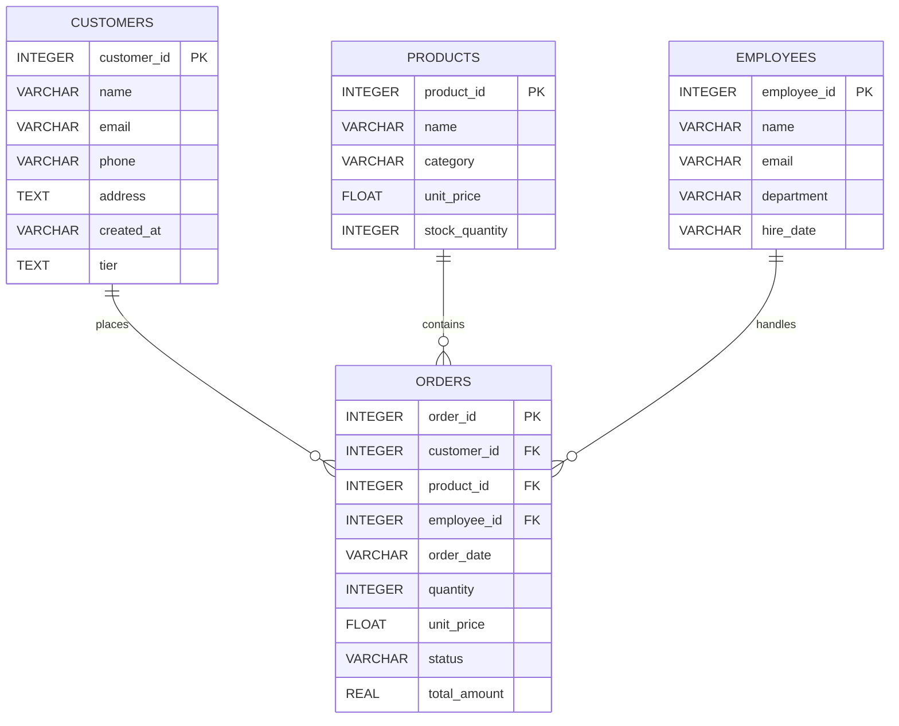

# customer.db ERD

`customer.db`의 SQLite 스키마를 기준으로 작성했습니다. `orders`는 고객, 상품, 담당 직원 각각을 참조합니다. 따라서 각 고객·상품·직원은 여러 주문에 연결될 수 있습니다(1:N).

## 관계

- `customers.customer_id` 1:N `orders.customer_id`
- `products.product_id` 1:N `orders.product_id`
- `employees.employee_id` 1:N `orders.employee_id`

PK는 기본키, FK는 외래키입니다. SQLite 스키마에서 확인한 타입을 표시했으며, `tier`의 기본값은 `일반`, `total_amount`의 기본값은 `0`입니다.
